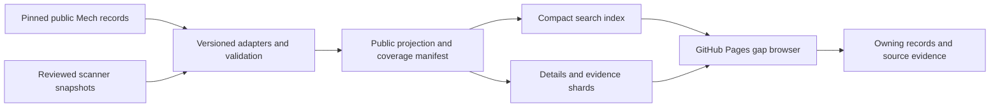

# Cross-Mech knowledge-gap browser: research and development plan

Research date: November 13, 2026 Pacific; evidence acquired November 14 UTC.
Status: proposed development plan, not an implemented or deployed browser.

## Recommendation

Build **`https://culturebotai.github.io/knowledge-gaps/`** in this repository.
Aggregate structured discussions from pinned canonical Mech records, preserving
their scientific context and evidence. Give every public corpus Mech a coverage
row, even when it cannot yet supply gap records. Keep automated scanner proposals
in a separately labelled view. Link the browser from `/mechs/` and relevant
record pages.

Start with the existing shared `Discussion` model and exporter in CLAW. Do not
invent a new scientific schema or scrape rendered pages. Add a versioned public
export contract in CLAW and a deterministic aggregation pipeline here. A static,
client-side browser with same-origin JSON assets fits the existing Jekyll Pages
deployment; a backend, vector database and LLM search are unnecessary for the
first version.

## Research baseline and limits

- Website baseline: [`87865943f6113041cb65c6d971c80e392fd594c9`](https://github.com/CultureBotAI/CultureBotAI.github.io/tree/87865943f6113041cb65c6d971c80e392fd594c9).
- Canonical CLAW baseline: [`3aff2ab37b9881a9a705e642cce6e93517b3dad5`](https://github.com/CultureBotAI/culturebotai-claw/tree/3aff2ab37b9881a9a705e642cce6e93517b3dad5).
  The raw `src/kg_microbe_fleet/fleet.yaml` was acquired at
  `2026-11-14T02:53:37Z`; SHA-256
  `1cf926eb16d70bfc81e120eb622b16063c4511e9c3d9cb534765a1f67621a91f`.
  Its bytes are retained locally under `.temp/gap-browser-20261113/fleet.yaml`;
  the full manifest is not republished in this public report.
- The website's existing membership snapshot pins older CLAW revision
  `7233987c85dcae9c248c7a2dbd445065e5a6c1b8`. This research uses the newer
  published manifest for capability declarations and the site's public corpus
  allowlist for the sixteen-corpus browsing scope. Infrastructure is reported
  separately: EdgeMech is not a scientific gap corpus; CLAW is the control plane.
- [Per-Mech evidence JSON](evidence/) records public repository identities,
  independently resolved default-branch SHAs, acquisition times, scanner
  declarations, config/schema observations and bounded discussion examples.
  This is a schema/adoption survey, **not a gap census or scientific review**.
  An empty example list does not establish zero discussions.
- Evidence collection reads pinned Git objects, including tracked files matched
  by ignore rules. Supporting local absence probes used `rg -uu`; those probes
  are limited to the named corpus/source directories and local revisions.
  CultureMech's remote recursive tree was truncated: complete `src`, `conf` and
  `app` subtrees were inspected, and its evidence explicitly marks the full tree
  incomplete. No current whole-corpus count is inferred from that response.
- Relevant issues and PRs were checked for dependencies. This was not an
  exhaustive review of every fleet issue. No literature scans or paid providers
  were run, and no scientific records were changed.
- At handoff, CLAW and website default-branch SHAs still matched the baselines
  above; overlapping PRs #1146 and #551 remained open. Individual corpus SHAs
  remain the acquired snapshots in `evidence/`, not a claim of an atomic fleet
  snapshot or a continuously current census.

## What already exists

The [governed shared schema](https://github.com/CultureBotAI/culturebotai-claw/blob/3aff2ab37b9881a9a705e642cce6e93517b3dad5/src/kg_microbe_governance/artifacts/schema/mech_shared.yaml)
defines `Discussion`, evidence, proposed experiments and lifecycle fields.
Kinds include `KNOWLEDGE_GAP`, `HUMAN_MODEL_MISMATCH`, `OPEN_QUESTION`,
`CONTROVERSY`, `CURATION_TODO`, `EMERGING_HYPOTHESIS` and `INTERPRETATION`.
Statuses distinguish `OPEN`, `UNDER_DISCUSSION`, `RESOLVED` and `ARCHIVED`.
The current exporter's strict gap grouping includes only `KNOWLEDGE_GAP` and
`HUMAN_MODEL_MISMATCH`; preserve that definition while offering all discussion
kinds as explicit filters.

The [existing exporter](https://github.com/CultureBotAI/culturebotai-claw/blob/3aff2ab37b9881a9a705e642cce6e93517b3dad5/src/kg_microbe_discussions/export.py)
and its template already provide search, facets, evidence links and theme
handling. Its projection loses full relative source paths, evidence support
levels/snippets, experiment text, dates and resolution details. Reuse the source
model and interaction patterns, extending the export rather than treating
existing `data.js` files as lossless or complete federation inputs.

The [scanner scope](https://github.com/CultureBotAI/culturebotai-claw/blob/3aff2ab37b9881a9a705e642cce6e93517b3dad5/docs/KGSCAN_SCOPE.md)
and [nightly workflow](https://github.com/CultureBotAI/culturebotai-claw/blob/3aff2ab37b9881a9a705e642cce6e93517b3dad5/.github/workflows/knowledge-gap-scan.yaml)
show four scheduled adapters: CultureMech, MediaIngredientMech, CommunityMech
and TraitMech. DUFMech is enabled for offline retained-abstract scanning, with
`scheduled: false`. ProteinTraitsMech's scanner is declared not applicable;
that does not prevent its native discussions being indexed. Others are disabled.

[Run 43450865399](https://github.com/CultureBotAI/culturebotai-claw/actions/runs/43450865399)
completed on November 13 and has four nonempty retained artifact archives.
Archive contents were not inspected here; nonempty archives do not establish
nonzero proposals. Retention is 90 days, so these artifacts need durable,
reviewed snapshots before becoming browser inputs.

## Applicability across all sixteen public corpus Mechs

“Discussion slot” below means the native record schema exposes it, not merely
that a shared schema file is vendored. Each row links its pinned evidence.
Scanner states are separate from native-record availability.

| Mech | Observed source surface | Development treatment |
|---|---|---|
| [HabitatMech](evidence/HabitatMech.json) | Native Discussion slot; scanner disabled. Local canonical habitat probe found no discussion keys. | Implement native extraction; establish complete root coverage before displaying an empty result. |
| [CommunityMech](evidence/CommunityMech.json) | Discussion examples; scheduled scanner and discussion export configured. Export glob covers communities, while isolates also contain discussions. | Include both `kb/communities` and `data/isolates`; do not copy the single-root export scope. |
| [TaxonMech](evidence/TaxonMech.json) | Native Discussion slot; scanner disabled. Published revision is ahead of the initially inspected local checkout. | Extract from the pinned current taxon corpus; population remains unmeasured here. |
| [TraitMech](evidence/TraitMech.json) | Native discussions, scheduled scanner and discussion browser. | Best first canary: canonical records contain corrections that older scanner reports do not reflect. |
| [PathwayMech](evidence/PathwayMech.json) | Inspected native schema has no Discussion slot; scanner disabled. | Show unsupported native extraction, then design a domain-reviewed slot/adapter in its own PR. |
| [CellStructureMech](evidence/CellStructureMech.json) | Native Discussion slot and populated examples, including curation todos; scanner disabled. | Use common adapter and preserve kind distinctions. |
| [ProteinTraitsMech](evidence/ProteinTraitsMech.json) | Populated native discussions despite scanner being not applicable. | Index discussions from canonical YAML, independently of the much larger ontology-derived browser corpus. |
| [DUFMech](evidence/DUFMech.json) | Native family-record discussions; offline scanner with retained evidence. | Use family records for gaps; the frozen seed worklist is a different denominator. Preserve candidate/review distinctions. |
| [NaturalProductMech](evidence/NaturalProductMech.json) | Native Discussion slot and populated examples; scanner disabled. | Common adapter over canonical product records; maintain structure and producer context. |
| [AntibioticMech](evidence/AntibioticMech.json) | Native Discussion slot and populated examples; scanner disabled. | Common adapter over canonical records. Domain audit reports need separate adapters, not wholesale ingestion. |
| [CMMMech](evidence/CMMMech.json) | Shared module imported, but inspected native material record has no Discussion slot; scanner disabled. | Explicit unsupported coverage until a domain-reviewed discussion adapter exists. Empty mechanisms are not automatically gaps. |
| [MediaIngredientMech](evidence/MediaIngredientMech.json) | Native discussions; scheduled scanner covers mapped records, discussion export has a broader ingredient glob. | Preserve different source denominators; exclude backups and avoid conflating distinct chemical forms. |
| [CultureMech](evidence/CultureMech.json) | Native Discussion slot; scanner/export configured over canonical merged media. | Trace derived merges to normalized recipe authority; avoid counting normalized and merged copies twice. Current population not counted here. |
| [AIMech](evidence/AIMech.json) | Imported-concept schema has Discussion slot. Maintained concepts have a separate schema with `limitations` and evidence-backed claims. Scanner disabled. | Audit both roots: the inspected fleet record glob names only `data/aio`, while the site's corpus also includes `data/curated`. Limitations are not automatically knowledge gaps. |
| [CofactorMech](evidence/CofactorMech.json) | Inspected native schema has no Discussion slot; scanner disabled. | Explicit unsupported native extraction; add scientific discussion support only through a reviewed domain change. |
| [AssayMech](evidence/AssayMech.json) | Inspected native schema has no Discussion slot; scanner disabled. | Same coverage treatment; assay applicability or missing measurement conditions need explicit semantics. |

Specific traps verified during the survey:

- CommunityMech's
  [BR1 isolate](https://github.com/CultureBotAI/CommunityMech/blob/76aa644cd6803ea2c9545d4c704276ede219d354/data/isolates/Microbacterium_BR1_Sulfadiazine_Cleaving_Isolate_Baseline.yaml#L192)
  carries a knowledge gap outside its existing discussion export glob.
  Its committed `app/discussions/` browser is also outside the inspected Pages
  workflow's `docs/` upload; the tested public discussion URL returned 404.
- TraitMech's
  [animal pathogen record](https://github.com/CultureBotAI/TraitMech/blob/2ccbc22ccfb8bd00c9d9ca70e11e020f818fbc18/data/traits/ecology/animal_pathogen.yaml#L365)
  documents corrections to scanner
  false positives; old `reports/knowledge_gap_scan.json` content must not
  supersede those canonical corrections.
- Importing or vendoring `mech_shared.yaml` alone does not establish a native
  record slot. Schema support, populated data, generated output and live
  deployment must be reported independently.

## Product behavior

The first screen answers “what is unknown, where, and what could resolve it?”
Use a labelled search field, Mech/kind/status/source filters, a compact coverage
summary, and paginated result cards or a responsive table. Default to active
explicit gaps; offer open questions, controversies, curation work, resolved and
archived items through visible controls. Show omitted categories and their
counts so the default is clear.

Search prompt, rationale, record label, source ID, discussion ID, actual aliases,
attached entity CURIEs and reference identifiers. Rank exact IDs first, then
label/prompt matches, then rationale/evidence metadata. Preserve punctuation in
exact CURIE/DOI matching. Do not advertise ontology expansion unless an explicit
versioned label/alias source supplies it. Support URL query/filter/sort/page
state, back/forward navigation, clear-all and a link to a specific gap.

Each detail view shows the question, owning Mech/record, kind, lifecycle, source
mode, documented review state, rationale, references and their support relation,
proposed experiments, dates, resolution, pinned source and live record link.
Review state defaults to **unspecified**, not “reviewed” merely because an item
was committed. Evidence counts are citation counts, not confidence scores.

Coverage is visible per Mech **and source root/mode**: supported, unsupported,
complete, partial, unavailable, stale or explicitly not applicable. A successful
complete extraction may yield zero items. An inaccessible or unscanned corpus
cannot. Display matching items, affected records and records inspected as
different quantities; do not compare raw gap counts as a Mech quality ranking.

Exports contain all filtered results, not just the current page, with source
provenance. Supply JSON and CSV, escape spreadsheet formula prefixes, and
preserve literal scientific text. Provide a static per-Mech summary and source
links when JavaScript is unavailable, plus distinct loading, failure, retry
and no-match states when it is enabled.

## Data contract and architecture

Put the reusable export schema/adapter contract in CLAW; retain scientific
authority in each Mech. Proposed site paths: `_gaps/` for source pins/configs,
`scripts/gaps/` for acquisition/normalization/build, `assets/gaps/` for public
assets, `knowledge-gaps.md` for the Jekyll shell, and dedicated JS/CSS. These
paths are a proposal, not files created by this planning change.

| Contract component | Required content and invariant |
|---|---|
| Identity | Repository identity + stable native record ID + local discussion ID; namespace all three. Reject collisions; define a migration map for source ID changes. Never use row position or mutable prose as the primary ID. |
| Native content | Preserve kind/status, prompt, rationale, attachments, experiments, dates and resolution. Preserve native missing values; do not invent dates or closure. |
| Evidence | Reference, support relation and available explanation; snippets only under the source's redistribution terms. `NO_EVIDENCE` means context without direct support, not absence of literature. |
| Provenance | Source repository, immutable commit, full relative file path and locator, content hash, adapter/schema version, acquisition/build time and source mode. Keep observation dates distinct from fetch dates. |
| Candidate lineage | Scanner run/config/version, source record revision, evidence hash and explicit links to accepted/rejected/superseded proposals where known. A match by text alone must not overwrite a curated item. |
| Coverage | Declared and actually inspected roots, total eligible/read/failed/excluded records where measured, source revision and freshness, errors, adapter support. Unknown denominator remains null, never zero. |
| Public boundary | Apply the site's public projection before building summaries, indexes, exports or retained metadata. Test the complete artifact tree, not only the visible page. |

Do not copy scanner scores into scientific priority or confidence. The current
scanner scores lexical signals in abstracts. Its packet lacks a complete
source/run envelope and per-record failure accounting, and scanning errors can
be skipped. Extend that producer contract before publishing candidates as
coverage-bearing data. Keep this extension off the native-discussion MVP's
critical path.

Build one compact global search projection with facetable metadata and lazy
detail shards. “Search all” must cover all indexed items, not only loaded
detail shards. Start with deterministic token/prefix matching in a Web Worker;
benchmark a vetted lightweight index only if measured volume warrants it.
Limit the rendered page to 50 results. Do not fetch GitHub APIs at visitor time.

Set initial engineering budgets, to be validated by the pilot: search projection
at most 2 MiB compressed, no detail shard over 500 KiB compressed, warm-query
p95 below 150 ms on a documented reference device, and a bounded 50-row DOM.
If these fail, partition the index with a complete searchable vocabulary and
worker coordination; never quietly restrict corpus-wide search. These are
proposed targets, not measured performance claims.

Pagefind is an alternative if static per-gap HTML becomes the desired detail
format. Its [post-build indexing model](https://pagefind.app/docs/) and
[filters](https://pagefind.app/docs/filtering/) are suitable, but would require
an explicit Jekyll → index → deploy workflow or checked-in generated output.
The present site uses legacy Pages from `main:/`; its existing Actions workflow
validates rather than deploys. Keep that deployment model for the first version.

GitHub documents a 1 GB published-site limit, a 10-minute deployment timeout,
and a 100 GB/month soft bandwidth limit. Keep raw corpora and scanner archives
out of deployed assets. See [GitHub Pages limits](https://docs.github.com/en/pages/getting-started-with-github-pages/github-pages-limits).

## Dependency-ordered implementation plan

Effort estimates are planning ranges in engineering days, excluding review
latency and scientific curation. The native-data MVP is approximately **8–13
days**, depending on adapter/root reconciliation; candidate ingestion and
domain-schema adoption are subsequent work.

| Wave / owner | Repositories and write set | Deliverable / exit condition | Estimate |
|---|---|---|---|
| 1 — contract owner | CLAW export module, public JSON schema, fixtures/tests; site `_gaps/` config | Freeze identity, coverage, kinds, provenance, safe public projection and compatibility rules. Reconcile manifest versus corpus roots and existing public-membership PRs. | 1–2 days |
| 2 — adapter owner | CLAW export adapter; site acquisition/build scripts and one TraitMech fixture snapshot | One real TraitMech extraction → validated files → populated local result → pinned source/evidence link. Confirm persistence, counts and corrected discussion behavior. No broad rollout before this passes. | 1–2 days |
| 3A — data owners | Independent adapter fixtures/configs for public Mechs; one integrator owns aggregate manifests | Extend shared adapter to supported Mechs; explicitly account for all sixteen. Include Community isolates, DUF family records, MIM exclusions, Culture merge lineage, AIMech separate roots. Unsupported native schemas remain labelled. | 2–3 days |
| 3B — UI owner | Site shell, JS/CSS, browser tests | Build search/facets/detail/export against frozen fixtures; URL state, source links, no-JS summary, accessible failure handling and measured budgets. Can run parallel to 3A after wave 2. | 2–3 days |
| 4 — integration/review owner | Site workflow, navigation source template, end-to-end tests and final assets | Deterministic full build, reconciled coverage, narrow/desktop verification, independent adversarial PR review and filed findings. Human merge decision; then verify actual deployed SHA and populated live results. | 2–3 days |
| Later — scanner owner | CLAW scanner envelope and site candidate adapter | One retained scan packet end to end, explicit unknown coverage for legacy packets, durable snapshots and curator outcome links. Then broaden. | 2–4 days |
| Later — domain owners | PathwayMech, CMMMech, CofactorMech, AssayMech and AIMech maintained schema as needed | Domain-reviewed discussion surfaces and validation, followed by governed adoption; no synthetic gaps created to fill the UI. | Scope after design review |

All integration writes to shared manifests and generated bundles have one owner.
Parallel adapters use separate PRs/worktrees and fixture sets. Canonical shared
schema changes must be released from CLAW before consumer updates; do not patch
vendored copies. The pilot should extend the exporter/public projection without
requiring a scientific schema change.

Refreshes should produce reviewed snapshot changes on a branch. A schedule can
detect newer sources and build candidate artifacts, but must not silently alter
public scientific content. On acquisition or validation failure, retain the
last good bundle and visibly mark its age/failed refresh. Merge remains the
maintainer's decision. A nightly scan should not run merely because the website
needs rebuilding.

## Acceptance and review gates

1. **Data fidelity:** every result resolves to a pinned native item; duplicate
   local IDs across Mechs remain distinct; resolved and archived records retain
   their history; missing kind/status remains unspecified. Preserve evidence
   support and full source path. Reject malformed records rather than skipping
   them invisibly.
2. **Coverage:** all sixteen public corpus Mechs represented; assertions of
   zero require a successful complete extraction over declared roots. Test
   Community isolates, Culture merged/normalized copies, MIM backups, AIMech
   dual roots and DUF seed-versus-family distinctions. No fleet-wide gap total
   until the item definition and coverage denominator are explicit.
3. **Corrections:** canonical TraitMech corrections win over historical scanner
   proposals; unreviewed candidates never become validated scientific claims.
   Similar questions can be linked but must not be destructively deduplicated.
4. **Search:** known exact ID, DOI, alias and prose queries; items in noninitial
   detail shards; combined filters; cold shared URL; sort before paging;
   complete filtered export; zero matches versus failed load.
5. **Safety/accessibility:** render markup as literal text, validate outbound
   links, protect CSV export, label controls, announce results, restore focus,
   use keyboard-operable disclosure and test contrast in supported themes.
   Test 390 px and desktop layouts with long identifiers.
6. **Reproducibility/publication:** same pins yield identical scientific payloads
   (separate run timestamps); hashes and counts reconcile; whole public artifact
   tree passes exclusion checks. PR review is read-only; file each finding,
   triage fixes, then seek the maintainer's merge decision. After merge, verify
   deployed content, not merely a successful job.

## Existing dependencies and follow-up work

- [Site PR #551](https://github.com/CultureBotAI/CultureBotAI.github.io/pull/551)
  and [CLAW PR #1146](https://github.com/CultureBotAI/culturebotai-claw/pull/1146)
  concern public membership projection. Coordinate wave 1 with them; the site
  PR's older fourteen-corpus narrative is not the current scope.
- [Site #552](https://github.com/CultureBotAI/CultureBotAI.github.io/issues/552)
  and [#553](https://github.com/CultureBotAI/CultureBotAI.github.io/issues/553)
  cover independent observation dates and filtering retained metadata. Apply
  those principles to gap manifests and archives too.
- [CLAW #674](https://github.com/CultureBotAI/culturebotai-claw/issues/674)
  tracks contrast in the shared discussion browser. Reuse interaction logic
  with verified site colors rather than copying its default accent unchecked.
- Before implementation, create task issues for the wave deliverables and
  reconcile overlap with the then-current queues. This planning session does
  not create sixteen speculative implementation issues or change upstream
  repositories.

## Reproducing this research

The helper is
[`scripts/adhoc/research_gap_browser_20261113.py`](../../../scripts/adhoc/research_gap_browser_20261113.py).
It uses `gh` read APIs, PyYAML, pinned Git objects and the site's public corpus
allowlist. Fetch the exact manifest revision linked above into a local ignored
path; pass it with `--manifest`, a checkout parent via `--local-root`, and an
output directory via `--output`. Use `--repo TraitMech` for a single-unit probe.
The helper resolves current default branches when rerun, so later outputs will
have new pins/times; retained JSON captures this research baseline.

An AIMech canary produced a nonempty evidence file that was read back before
broader collection. The later CultureMech truncated-tree case was fixed and
rerun alone; the resulting file explicitly records incomplete whole-tree
coverage. These canaries validate evidence acquisition and persistence, not
the proposed production exporter, corpus completeness or search performance.
